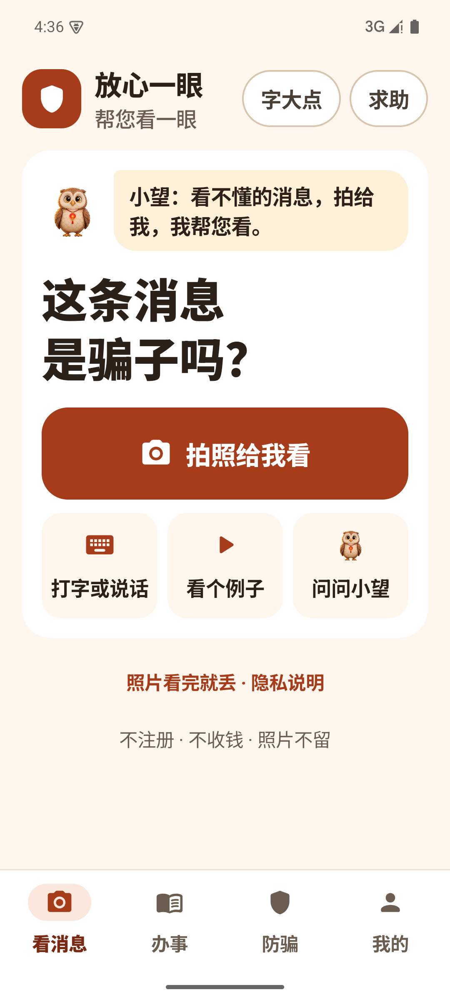
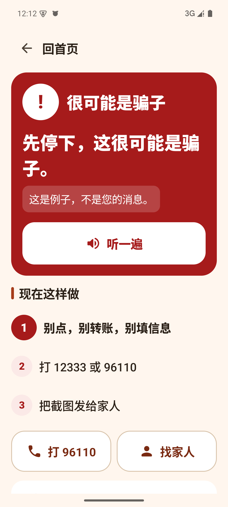
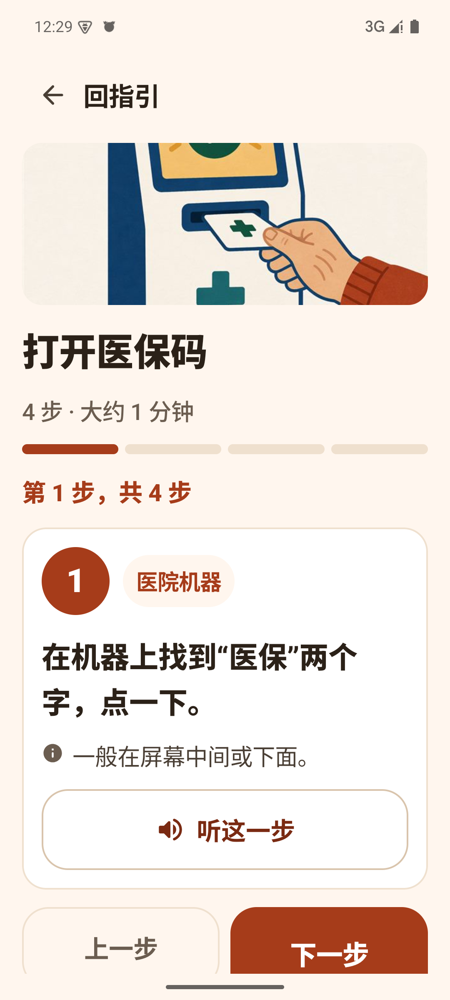
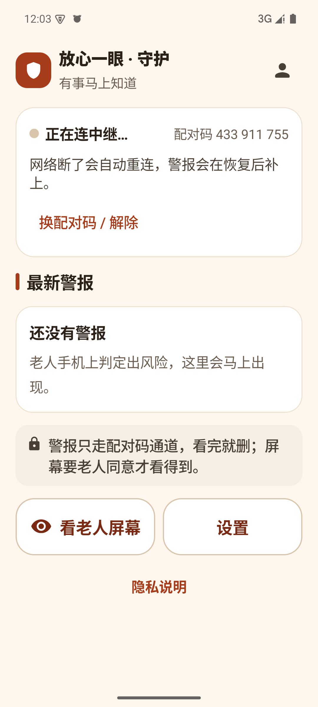
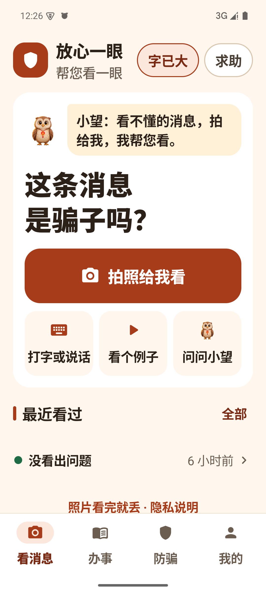
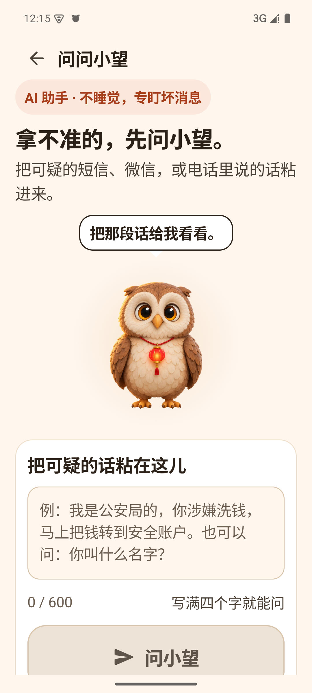

# 放心一眼（Android）

给 55–75 岁、文化程度不高的长辈用的识诈与办事工具。**一个 App，两种身份**：

- **我是中老年人**：拍一张可疑短信/通知，或把字贴进来，给出红/黄/绿三色结论和三步动作，可朗读、可转发给家人；外加大字办事指引。
- **我是守护人（子女）**：收到老人那边的警报推送，看警报详情，老人在本机同意后还能实时看到老人屏幕，远程教他怎么办。

首次打开先选身份，选完记住；两边的设置页都能随时换成另一种身份。老人和子女不是同一台手机时，靠 **9 位配对码** 连上同一个云端中转（Qoder Sites 上的 Edge Function + 数据库）。旧版 6 位码仍可连接，只为兼容已配对的设备。

> **在线产品页**：https://fangxin-yiyan-oqspdkiq3lk.qoder.zone/
>
> **产品说明**：[产品说明](docs/product.md)
>

## 产品背景

「放心一眼」面向 55–75 岁、文化程度不高的长辈：他们真正缺的不是反诈知识，而是把一段陌生文字翻译成一句能听懂的话和一个能执行的下一步。

核心动作只有一个：拍一张照、截一张图，或把文字贴进来，得到红 / 黄 / 绿三色结论和三条具体动作。结论、原因和话术全部走模板，不交给模型自由发挥；看不清、字太少时给黄色兜底，绝不报“安全”。

产品同时提供两种身份：

- **中老年人**：识诈判断、大字办事指引、朗读、向家人求助。
- **守护人（子女）**：接收老人端的风险警报，经老人每次同意后远程查看屏幕并指导操作。

网页版与 Android 原生版共用同一套判定口径。本仓库是 Android 原生实现，在线体验请打开上面的产品网页。

### 三个典型场景

1. 收到“社保卡今日停用，点击链接认证”的短信，页面要求填写身份证和银行卡号——先停一下，给出红色结论、可疑依据和 12333 / 家人求助动作。
2. 在医院自助机前不知道怎么调出医保电子凭证——拍屏幕，返回分步大字说明，每步不超过 40 字。
3. 已经点开链接、填了一半才慌——第一屏先给止损动作：停止填写、联系银行、告诉家人、保留截图。

## 界面预览

| 老人端首页 | 风险结论 |
| --- | --- |
|  |  |

| 学防骗 | 办事指引 |
| --- | --- |
|  |  |

| 守护人端 | 大字模式 |
| --- | --- |
|  |  |

| 我的 | 问问小望 |
| --- | --- |
|  |  |

## 运行

1. Android Studio（Ladybug 或更新）打开本目录。
2. 使用 **JDK 17**，安装 **Android SDK 35**。
3. 连接手机或启动模拟器，运行 `app`。
   - 相机需要真机或带相机的模拟器；相册、打字、例子、指引不依赖相机。
   - 朗读依赖系统中文 TTS；语音输入依赖系统语音识别服务。
4. 双端联动默认已经连好云端中转，**不用起任何本地服务**：
   `DEFAULT_RELAY_URL = https://fangxin-yiyan-oqspdkiq3lk.qoder.zone`（`domain/Types.kt`）。
   两台手机装同一个版本、填同一个配对码即可。要换成自建中转，在双方“设置 → 连不上时”里填同一个地址。

> 目录里的 `relay-server/` 是早期自建 WebSocket 中继，App 已不再使用，仅留作本地调试参考。

命令行（可选）：

```bash
./gradlew :app:assembleDebug
./gradlew :app:testDebugUnitTest
./gradlew :app:assembleRelease    # 交付包，产物 app/build/outputs/apk/release/放心一眼.apk
```

Windows 下用 `gradlew.bat`；本目录含中文时 cmd 会把它截断成无效路径，改用 Git Bash 执行
`JAVA_HOME=<JDK17> ./gradlew :app:assembleRelease`。

## 双端怎么连、怎么用

1. 老人手机选“我是中老年人”，设置页里拿到 9 位配对码（屏幕上按 3-3-3 分组显示）；**分组念给子女**。
2. 子女手机选“我是守护人”，输入配对码点“连上老人手机”。双方状态点变绿即在线。
3. 老人这边识别出红/黄结论（绿卡和例子不推），自动把 **打码后的结论** 推给守护人，守护人收到高优先级通知。
4. 守护人在警报页点“看看老人屏幕”，老人手机会弹出“家人想看看您的屏幕”，**每次都要老人自己点同意**，再走系统录屏授权（Android 14+ 已固定为整屏，不再让老人挑应用）。
5. 共享最多 5 分钟、每秒 1 帧、480 像素宽；通知栏、结果页都能随时“停下”；画面在内存里转码，云端只留最新一帧（20 秒不更新自动丢，停下即删）。

**云端中转怎么走**（`link/LinkClient.kt` → Qoder Sites `functions/v1/app/relay`）：

| 接口 | 用途 |
| --- | --- |
| `POST /relay/join` | 进房间、拿对端在线状态与当前帧序号 |
| `POST /relay/send` | 投递警报 / 屏幕开关 / 看屏幕请求 |
| `POST /relay/poll` | 每 1.5 秒取一次：对端消息（读走即删）、在线状态、最新一帧 |
| `POST /relay/frame` | 老人端推最新一帧（≤200KB） |
| `POST /relay/stop` | 停止共享时立即删掉云端那帧 |

- 昵称只用角色（elder / guardian），不存账号、不存设备标识。
- 消息留在房间里，**对方取走就删**，最长 10 分钟；屏幕帧 20 秒过期；在线状态 15 秒过期。
- 断线自动重连：2 秒起指数退避，最长 10 秒一次。

## 产品底线（写进代码，不靠自觉）

- **不用注册、不用登录**，没有任何账号体系；配对码只是把两台手机连到同一个房间。
- **照片只在内存里处理**：解码 → 识字数 → 立即回收；不写文件、不上传。
- **卡号、身份证、手机号只留后四位**展示（`TextMasking`），推送给家人的警报同样先打码。
- **本机历史最多三条**，只存结论文字，不含图片（`HistoryPolicy`）。
- **屏幕共享有边界**：每次单独同意、最多 5 分钟、1 fps、480px 宽、不保存；云端只留最新一帧，20 秒没更新就丢，停下就删。
- **只用模板话术**：结论、原因、动作来自 `Copy`，不由模型自由生成。
- **两层保守判断 + 黄色兜底**：规则命中与语义特征两层叠加；看不清、字太少时给黄色兜底卡，绝不报“安全”。
- 识数用 ML Kit 本机中文识别，离线可用，不向服务端发送正文。

## 目标人群对应的设计取舍

| 长辈的困难 | 这里的做法 |
| --- | --- |
| 字小看不清 | 正文 ≥20sp、标题 24–34sp，首页一键“字大点”（整体 ×1.15） |
| 不会读长句 | 一屏一件事；结论一句话，动作用三步卡片 |
| 不知道点哪里 | 主按钮 ≥76dp、次按钮 ≥68dp，整卡可点，返回键 56dp |
| 不会打字 | 拍照/相册优先；可说话输入；例子可先看 |
| 怕点错、怕被骗 | 红色先劝停；转账类给专门的“停下”动作；全程可朗读 |
| 遇事找子女 | 老人端推警报给守护人；“发给家人”分享结论；“打给家人”按存好的号码一键拨号 |
| 怕隐私泄露 | 首页明示“照片不留”，隐私说明用大白话，记录可一键清空；录屏每次同意、5 分钟封顶、不保存 |

## 界面

按首次选择分成两套：

**老人端**

- 首页：拍照 / 打字说话 / 先看个例子；三色图例；三条大字指引；最近看过（≤3）；96110 与家人设置。
- 识诈：拍照（CameraX）、相册、文字/语音输入 → 结果页（三色结论、三步动作、朗读、为什么、打码原文、发给家人）。
- 结果页：红/黄/绿配色；红色有“别再转钱”分支；兜底卡引导重拍或贴文字；“让家人看看屏幕 / 家人正在看您的屏幕 + 停下”。
- 指引：分类列表 → 分步详情（进度、朗读此步、上一步/下一步）→ 办好了。
- 设置：跟家人手机连上（配对码）、大字开关、家人电话、连不上时（中继地址）、清空记录、换成守护人界面、隐私说明。
- 求助：96110 / 家人 / 12333。

**守护人端**

- 首页：配对码输入或已配对状态（老人手机在线/未连上/正在连中继）；最新警报列表；看老人屏幕；设置。
- 警报详情：风险色、一句话结论、打码原文、三步动作、看他正在用的屏幕、打 96110。
- 看屏幕：全屏实时画面、绿色在线点、老人没打开时的提示与“提醒老人打开屏幕”；最多 5 分钟。
- 设置：中继地址、解除配对、清空警报、换成老人界面、隐私说明。

## 代码结构

```
app/src/main/java/com/fangxin/yiyan/
├── MainActivity.kt          # 首启身份选择；老人/守护人两套 NavHost 与各自的弹层
├── FangxinViewModel.kt      # 识别、历史、设置、配对、警报流、屏幕请求与画面
├── domain/                  # 纯 Kotlin：规则、判定、掩码、话术、指引、样例、角色与警报模型
├── data/AppRepository.kt    # SharedPreferences 单例：历史 ≤3、设置、配对码、警报 ≤20
├── link/LinkClient.kt       # OkHttp HTTP 轮询：配对、警报、屏幕请求、帧转发、在线状态
├── link/GuardianNotify.kt   # 通知渠道与文案（警报高优先级、守护常驻、屏幕共享）
├── service/GuardianLinkService.kt   # 守护人端常驻连接（前台服务，id 71）
├── service/ScreenShareService.kt    # 老人端录屏转发（前台服务，id 72；1 fps / 480px / ≤5 分钟）
├── ocr/OcrEngine.kt         # ML Kit 中文识别（本机）
├── speech/SpeechController.kt
├── ui/components/           # 大字按钮、卡片、图例、底部弹层
├── ui/screens/              # 角色选择、老人端页面、守护人端页面
└── util/                    # 拨号、分享、图片解码/旋转、时间与号码格式
app/src/test/java/.../domain # 24 个单元测试
relay-server/                # 早期自建 ws 中继，App 已不再使用（保留作本地调试参考）
```

## 判定口径

与网页版共用同一套规则（`domain/RiskRules.kt`、`domain/RiskCheck.kt`）：

- 红色：命中凭据/转账/冒充/私下办理等高危词，或两条以上黄色特征叠加。
- 黄色：催办、退款、贷款、投资、中奖等可疑特征，或家人换号借钱。
- 绿色：无命中且不像通知类话术，同时提示“动钱先核实”。
- 兜底：文字过少、识别置信度低且无证据时给黄色兜底卡。

改口径只改 `RiskRules` / `RiskCheck`，页面与话术不动。

## 测试

`app/src/test/java/com/fangxin/yiyan/domain/`：

- `RiskCheckTest`：三条样例判定、验证码/转账/冒充/催办、短文本兜底、低置信度兜底。
- `TextMaskingTest`：卡号、身份证、验证码、手机号只留后四位。
- `HistoryPolicyTest`：最多三条、去重、倒序。
- `GuidesTest`：指引完整性、分类与查找。

## 当前验证状态

2026-11-17 在本机完成验证：

- `:app:assembleDebug` 构建成功，产物 `app/build/outputs/apk/debug/app-debug.apk`。
- 单元测试 24 个全部通过（JUnit 4）。
- Pixel 6 / Android 15 模拟器实机走查通过老人端：首页、三条样例、红色判定页三条行动、语音播报、
  打字或说话、拍照入口、大字指引列表与分步、办好了页、最近看过、求助与隐私弹层、字大点开关。
- **Qoder Sites 云端中转全链路走查通过**（测试房间，守护人端真机 UI + 模拟老人端调用云端接口）：
  - 守护人输入配对码后显示“老人手机在线”；对端下线后显示“老人手机还没连上”。
  - 模拟老人投递红色警报 → 守护人首页 1~2 秒内出现“很可能是骗子 · 刚刚”卡片，
    同时收到高优先级通知“紧急：家里老人可能遇到骗子”。
  - 守护人点“看老人屏幕 → 提醒老人打开屏幕” → 云端消息箱收到 `screen_request`（读走即删）。
  - 模拟老人推一帧 480×800 JPEG → 守护人全屏页立即显示该画面。
  - 调用 `/relay/stop` 后，再以守护人身份轮询，`frame` 为 `null`，云端不再留画面。

2026-11-19 交付包构建与发布验证：

- `:app:assembleRelease` 构建成功，产物 `app/build/outputs/apk/release/放心一眼.apk`（versionCode 8 / versionName 1.0.6，22,627,187 字节）。
- `apksigner verify` 通过（APK Signature Scheme v2），签名证书 `CN=Fangxin Yiyan`，来自 `keystore/fangxin-release.jks`；
  `aapt2 dump badging` 确认桌面应用名为「放心一眼」、包名 `com.fangxin.yiyan`。
- 安装包已发布到 QoderCN 站点，线上 `https://fangxin-yiyan-oqspdkiq3lk.qoder.zone/download/fangxin-yiyan.apk`
  返回 200 且字节数与本地一致；介绍页、帮助页、隐私页的下载按钮保存名为「放心一眼.apk」。
- 线上中转回归：`/relay/health` 返回 `{"ok":true}`；`/relay/join`（elder）返回 `presence.elder=true`，
  同房间 `/relay/poll`（guardian）读到在线状态，数据库读写正常。

2026-11-20 应用图标更换与 1.0.7 发布验证：

- 桌面图标换成软 3D 猫头鹰（戴金丝圆框眼镜、胸前红灯笼、奶油底+金环背景），源图 `vibe_images/yiyan-icon-bg-b-cream_*.png`。
  自适应图标仍是一层结构：`mipmap-anydpi-v26/ic_launcher.xml` 的 background 指向 `drawable-nodpi/ic_launcher_full.png`，
  foreground 为透明，`minSdk = 26` 所以不需要各密度旧版 PNG。新图 1024×1024、915,505 字节。
- 按自适应图标 66dp 安全区（108dp 层的中心 61%）做过合成遮罩预览：眼镜、脸、灯笼完整，仅脚底被圆角削掉一点。
- `:app:assembleRelease` 构建成功，产物 `app/build/outputs/apk/release/放心一眼.apk`（versionCode 9 / versionName 1.0.7，23,292,839 字节）。
  `apksigner verify` 通过，证书仍为 `CN=Fangxin Yiyan`（与 1.0.6 同一把 `keystore/fangxin-release.jks`，覆盖安装依赖签名一致）；
  `aapt2 dump badging` 确认 `versionCode='9' versionName='1.0.7'`、桌面名「放心一眼」；`aapt2 dump resources` 里
  `drawable/ic_launcher_full` 指向的 `res/fE.png` 与源图 md5 一致，确认新图标确实进了包。
- 站点已发布到 QoderCN（新 actionId `ced88e9d-3c62-4066-9833-c1cc7e28300a`，`published=true`）：
  首页 200 且版本卡显示 v1.0.7；`https://fangxin-yiyan-oqspdkiq3lk.qoder.zone/download/fangxin-yiyan.apk`
  Content-Length 23,292,839，整包下载后 md5 与本地构建完全一致；
  `/functions/v1/app/api/health` 返回 `{"ok":true,"database":"ok"}`，`/functions/v1/app/relay/health` 返回 `{"ok":true}`。
  主域 `/relay/health` 返回 404 属平台路由规则（函数只在 `/functions/v1/app/…` 暴露），不是故障。

已知限制：

- 未做真机覆盖安装实测：1.0.6 → 1.0.7 同签名同包名，升级安装与全新安装理论兼容但未验证；新图标在真机桌面与不同启动器
  遮罩下的实际显示效果也只做了合成预览。
- 1.0.6 交付时同样只改了安装包命名与桌面显示名，未重装覆盖已有 1.0.6（同 versionCode 8）复走 UI。
- 相册选图、真实拍照识别、TTS 在真机上的音色未验证（模拟器无真实场景）；`96110` 拨号按钮只验证了可点，未真实外呼。
- 双机跨设备走查未做（手头只有一台模拟器），对端用云端接口模拟；两台真机同房间的并发时序未压测。
- 屏幕共享 5 分钟自动停止、守护端全屏画面的长时间稳定性未做满时长验证（代码里 `MAX_DURATION_MS = 5 分钟`）。
- 中转依赖 Qoder Sites 站点可用性；“连不上时”里的地址可改，但两台手机必须填同一个。
- 工程目录含中文时，`:app:testDebugUnitTest` 的 Gradle 测试 Worker 会报
  `ClassNotFoundException`（类路径非 ASCII 导致），`assembleDebug` 不受影响；
  跑测试请把工程放到纯英文路径（或复制一份到英文路径）后执行。
